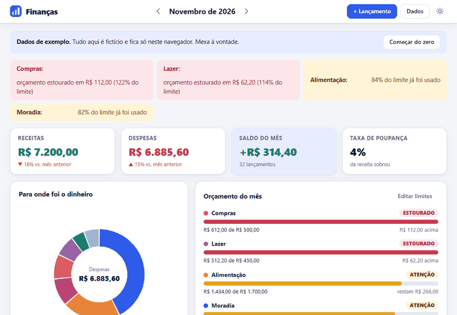
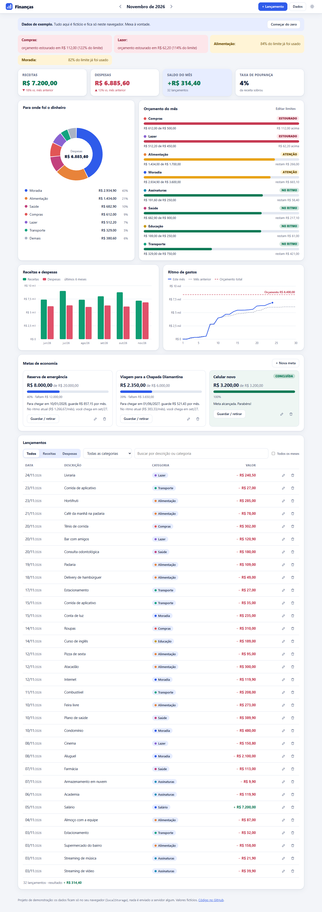
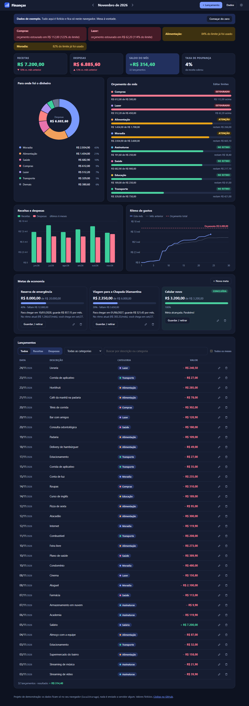
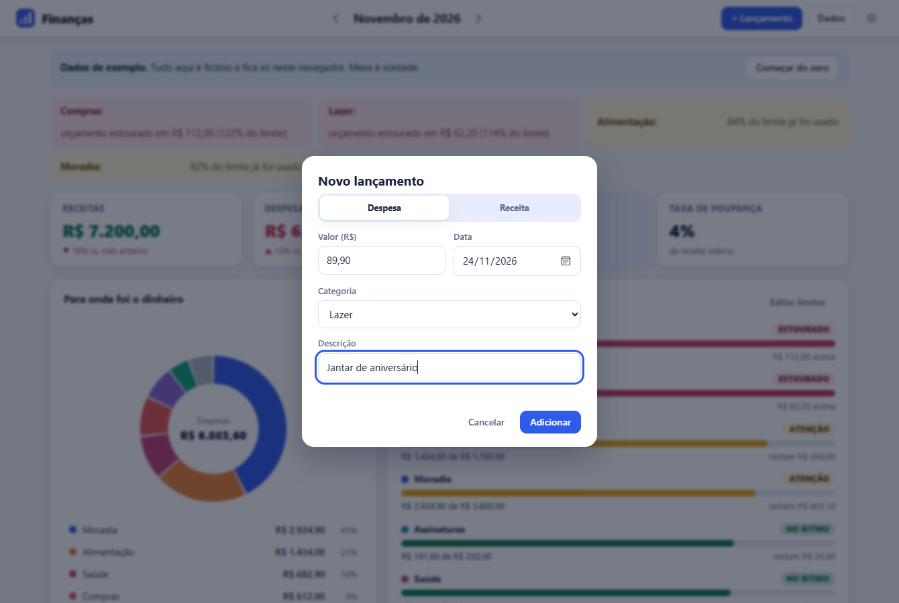
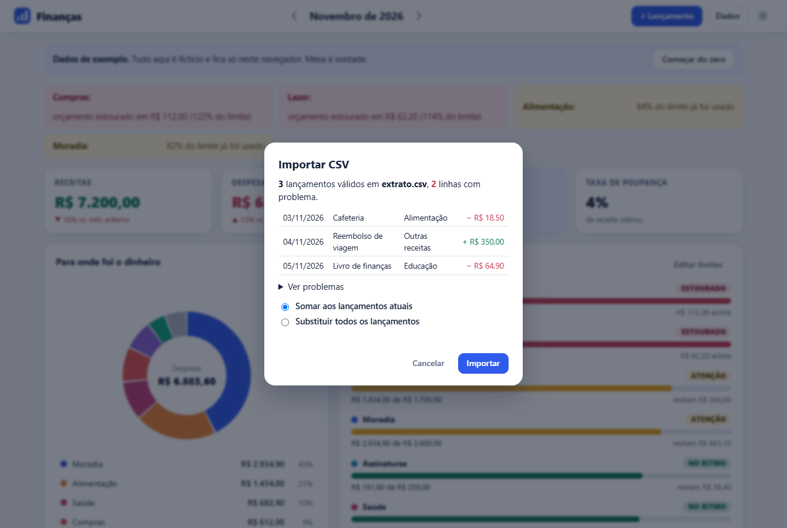
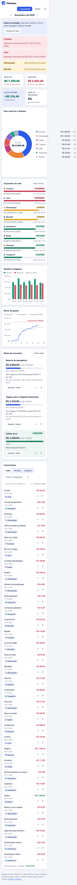

# Finanças Pessoais

Painel de finanças pessoais que roda inteiro no navegador, sem backend: lançamentos de receitas e despesas com categorias, orçamento por categoria com alertas, metas de economia, gráficos próprios em SVG (rosca, barras e linha do tempo), importação e exportação de CSV, filtros por mês e modo escuro. JavaScript puro, zero dependências, dados guardados no `localStorage`.

**Experimente agora: <https://luizrenatodc.github.io/financas-pessoais/>**

[](https://github.com/luizrenatodc/financas-pessoais/actions/workflows/testes.yml)
[](LICENSE)

> Projeto de demonstração. Todos os valores e lançamentos de exemplo são fictícios.



## Veja funcionando

O GIF acima é gravado de verdade: um navegador abre o painel, preenche o formulário, filtra, troca de mês e liga o modo escuro. Nada é montado à mão.

| Tema claro | Tema escuro |
|---|---|
|  |  |

| Novo lançamento | Importar CSV |
|---|---|
|  |  |

| Celular |
|---|
|  |

## Como rodar

Online, pelo link acima. Local:

```bash
npm start            # servidor estático em http://localhost:3000 (usa só o Node)
# ou: python -m http.server  /  npx serve .
npm test             # 50 testes da lógica de cálculo
```

Não há build: o navegador carrega `index.html` e os módulos de `src/` direto. Na primeira visita o painel nasce com seis meses de dados fictícios. **Dados > Apagar todos os dados** (ou o botão "Começar do zero") deixa tudo vazio para você usar de verdade.

Dica de demonstração: `?hoje=2026-11-24` na URL finge outra data de hoje (útil para ver alertas de fim de mês), e `?mes=2026-09` abre um mês específico.

## O que dá para fazer

| Recurso | Como funciona |
|---|---|
| Lançamentos | receitas e despesas com valor, data, categoria e descrição; editar, excluir (com "Desfazer") e criar categorias na hora. Atalho `N` abre o formulário |
| Mês | navegação mês a mês; todos os indicadores e gráficos seguem o mês escolhido |
| Indicadores | receitas, despesas, saldo e taxa de poupança, com variação frente ao mês anterior |
| Orçamento | limite mensal por categoria; barra verde até 80%, amarela de 80% a 100% ("Atenção") e vermelha acima ("Estourado"); alertas no topo |
| Metas de economia | valor-alvo e prazo opcional; aportes e retiradas; mostra quanto guardar por mês para chegar no prazo e a previsão no ritmo atual |
| Gráficos | rosca de despesas por categoria (clicar na legenda filtra a lista), barras de receitas e despesas dos últimos 6 meses e linha de gastos acumulados contra o mês anterior e o orçamento total |
| CSV | exporta o mês ou tudo, no formato do Excel brasileiro; importa vários formatos, mostra uma prévia, aponta cada linha ruim e ignora duplicados |
| Filtros | tipo, categoria, busca por texto e "todos os meses" |
| Tema | claro e escuro, seguindo o sistema ou escolhido no botão |
| Acessibilidade | HTML semântico, foco visível, diálogos nativos (`<dialog>`), gráficos com `role="img"` e descrição em texto, estados do orçamento escritos (não só cores), tabela que vira lista no celular |

## Decisões de projeto

- **Dinheiro em centavos inteiros.** Nenhuma conta usa ponto flutuante; a leitura de texto (`1.234,56`, `1234.56`, `R$ 12,5`, `(45,90)`) arredonda por texto e há testes para os casos ambíguos.
- **Datas como texto `AAAA-MM-DD`.** Sem objetos `Date` nas contas, então fuso horário não desloca lançamento de dia.
- **Lógica separada da tela.** `src/calculos.js`, `csv.js`, `dinheiro.js`, `datas.js`, `graficos.js` e `dados.js` não tocam no DOM e são testados no Node. `src/app.js` só desenha e trata eventos.
- **Gráficos sem biblioteca.** `graficos.js` devolve texto SVG puro: caminhos de arco para a rosca, escala "bonita" para os eixos (degraus 1, 2, 2,5 e 5), dica em cada barra, fatia e dia (`<title>`). As cores vêm de classes CSS, então o tema escuro não exige mexer no código dos gráficos. Os gráficos são redesenhados na largura real do contêiner, e a rosca agrupa as menores categorias em "Demais".
- **CSV seguro.** Texto que começa com `=`, `+`, `-` ou `@` é prefixado com apóstrofo na exportação (evita injeção de fórmula ao abrir na planilha) e restaurado na importação.
- **Armazenamento tolerante.** O que vem do `localStorage` é validado item a item: JSON quebrado, datas impossíveis ou valores inválidos são descartados em vez de travar o painel. Se o navegador bloquear a gravação, o painel avisa e segue funcionando.

## Estrutura

```
index.html, estilo.css, icone.svg   página e estilos
src/app.js        interface e eventos
src/calculos.js   totais, categorias, orçamento, metas, séries e filtros
src/csv.js        exportação e importação
src/dinheiro.js   centavos: leitura e formatação
src/datas.js      datas e meses como texto
src/graficos.js   rosca, barras e linhas em SVG
src/dados.js      formato, categorias padrão, validação e armazenamento
src/semente.js    dados fictícios gerados a partir da data de hoje
test/             50 testes (node --test)
scripts/          servidor estático, capturas de tela e GIF
```

## Limites honestos

- Os dados vivem só no navegador (por site e por navegador): limpar os dados do site apaga tudo e não há sincronização entre aparelhos. Use **Exportar tudo** como backup.
- Não há contas de banco, conciliação nem moedas além do real; categorias não podem ser renomeadas ou excluídas depois de criadas.
- Os aportes das metas são independentes dos lançamentos: não mexem no saldo do mês.
- O `localStorage` tem cota de alguns MB; a tabela mostra os 300 lançamentos mais recentes do filtro.
- Os gráficos não têm animação nem zoom; a dica por dia/barra depende do `<title>` nativo do SVG (mouse; no toque aparece só em alguns navegadores).

## Autor

Luiz Renato Carvalho, [luizrenato.dev](https://luizrenato.dev). Licença [MIT](LICENSE).
